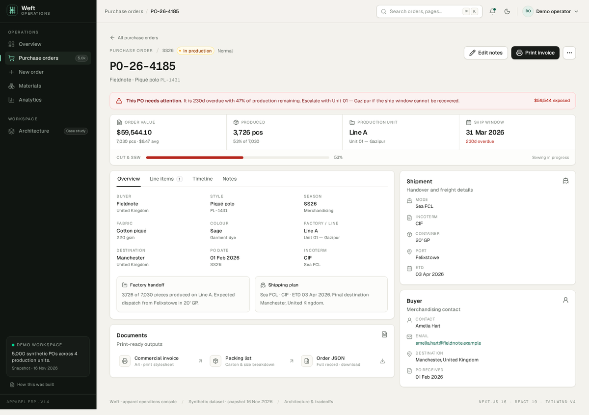
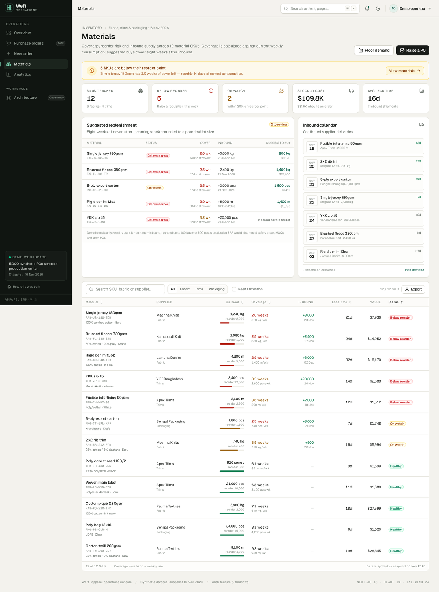
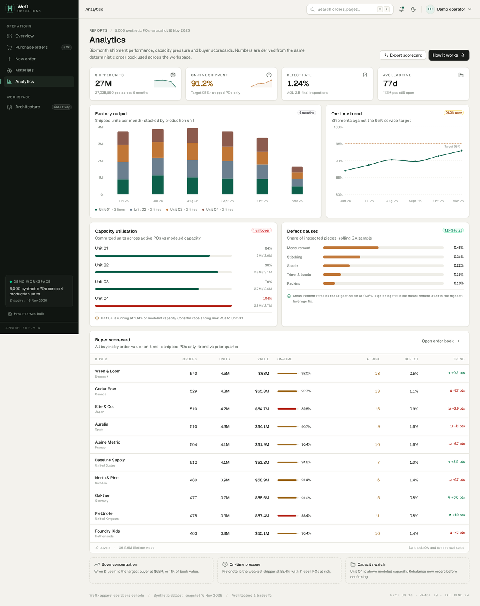
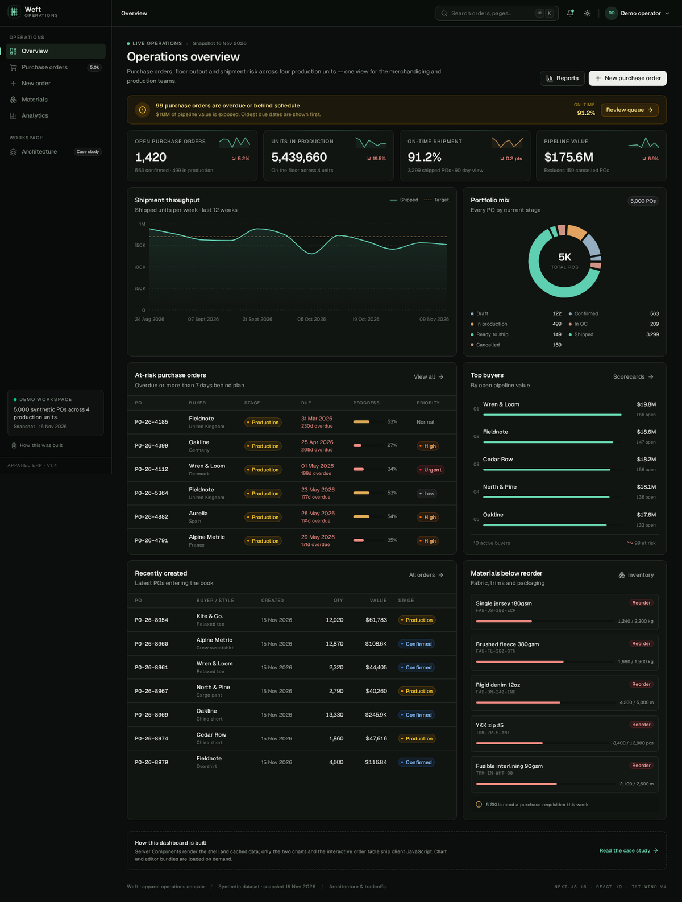
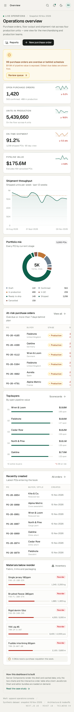

# Weft

**A data-dense apparel-manufacturing operations console built with Next.js 16, React 19 and TypeScript.**

Weft is a portfolio project, not a landing page. It models the unglamorous parts of an ERP front end: a 5,000-row virtualized order book, typed multi-step forms, server/client boundaries, explicit caching, print-ready commercial documents and honest browser-local persistence.

> **Live demo:** _pending Vercel deployment — see [Deploying](#deploying)._ Replace this line with the production URL after the first deploy.
>
> **Architecture case study:** in-app at `/architecture` · **Sample invoice:** [two-page A4 PDF](docs/weft-sample-invoice.pdf)


## Why this exists

Data-heavy business software is mostly judged in the details. A marketing page cannot demonstrate whether you can keep a 5,000-row grid responsive, split server and client components sensibly, validate one schema on both sides of the wire, or produce a document that prints without breaking.

Apparel manufacturing supplied the constraints: purchase orders, style/colour/size matrices, production stages, material coverage, factory capacity, buyer scorecards and shipping paperwork. Every screen has a job because the domain needs it, not because a component library had a demo.

The entire workspace runs on Vercel's free tier with no database, auth service or paid API.

## Screens

| Purchase order explorer | Order detail |
| --- | --- |
|  |  |

| New purchase order | Printable invoice |
| --- | --- |
|  |  |

| Materials | Analytics |
| --- | --- |
|  |  |

### Dark mode and mobile

| Dark mode | Mobile |
| --- | --- |
|  |  |

## What is in the app

| Route | What it demonstrates |
| --- | --- |
| `/` | Server-rendered KPI grid, 12-week throughput chart, shipment-risk queue, buyer concentration and a five-SKU low-stock callout. |
| `/orders` | 5,000 POs in a TanStack Table + Virtual grid. Sort, global search, stage/buyer/risk filters, column visibility, row selection, density preference, URL-addressable filters and CSV export. |
| `/orders/new` | Three-step React Hook Form wizard with a shared Zod schema, per-step validation, API submission and a recoverable Zustand draft. |
| `/orders/[id]` | Order summary, size allocation, line items, production timeline, lazy Tiptap notes and shipment/buyer rail. |
| `/orders/[id]/invoice` | Two-page A4 commercial invoice and packing list with totals, amount in words, carton allocation and a Code 39-style barcode. |
| `/materials` | Twelve fabric/trim SKUs with coverage weeks, reorder states, inbound supply and suggested buys. |
| `/analytics` | Factory output, on-time trend, capacity utilisation (Unit 04 intentionally over capacity), defect causes, buyer scorecards and CSV export. |
| `/architecture` | The engineering case study: RSC boundaries, cache design, grid tradeoffs, measured bundles, print strategy, accessibility and what was deliberately left out. |
| `/api/orders` | `GET` cached JSON for the dataset; `POST` validates a new PO with the same Zod schema and returns `persisted: false`. |

Cross-cutting details: command palette on <kbd>⌘</kbd>/<kbd>Ctrl</kbd>+<kbd>K</kbd>, light/dark themes, skip link, reduced-motion support, mobile slide-over navigation, custom 404/error boundaries, toasts and visible focus states.

## Stack

| Layer | Choice |
| --- | --- |
| Framework | Next.js 16.4.6 App Router, React 19.3.0, TypeScript 5 |
| Rendering | React Server Components, Cache Components, Partial Prefetching, React Compiler |
| Styling | Tailwind CSS 4.3.3, CSS custom-property design tokens, Geist Sans/Mono |
| Data grid | TanStack Table 8, TanStack Virtual 3 |
| Forms | React Hook Form 7, Zod 4, `@hookform/resolvers` |
| Client state | Zustand 5 with `persist` + `skipHydration`; SWR 2.5 for the read path |
| UI | Radix UI primitives, cmdk, Sonner, Lucide icons, next-themes |
| Charts | Recharts 3, loaded lazily |
| Editor | Tiptap 3 + DOMPurify, loaded on demand |
| Tests | Vitest 5 |

## Architecture

```text
Server Components                     Client islands
─────────────────                     ──────────────
dashboard  ─┐                         orders explorer (Table + Virtual)
orders     ─┤                         charts (Recharts, lazy)
detail     ─┼──► src/lib/data/server.ts ──► seeded generator
invoice    ─┤       "use cache"            5,000 deterministic POs
materials  ─┤       cacheLife / cacheTag   fixed snapshot: 16 Nov 2026
analytics  ─┘
                                     Browser-local state
API route                            ───────────────────
GET  /api/orders  cached JSON        drafts, created POs, notes,
POST /api/orders  Zod → 422/201      table density (Zustand persist)
```

The data layer is deliberately shaped like a repository. `generateOrders()` is a seeded generator: a fixed anchor date and a mulberry32 PRNG produce the same 5,000 purchase orders on every server and every build. Buyer, style, factory, progress, risk and due dates all come from that one stream, so the dashboard, explorer, detail page, invoice and analytics cannot disagree.

```ts
// src/lib/data/server.ts
export async function getOrders() {
  "use cache";
  cacheLife("days");
  cacheTag("orders");
  return generateOrders();
}
```

The dashboard refreshes hourly; the order book and detail records are cached daily. `/api/orders` adds a one-day `s-maxage`. Cache tags make invalidation a one-line change when a real mutation arrives.

**Server/client line.** Layout, KPI grids, risk queues, order summaries, invoices and analytics copy are Server Components. Client islands exist only for interaction: the table, charts, command palette, theme toggle, form, notes editor and print toolbar. Charts and Tiptap are lazy-loaded so their weight stays off first paint.

**State ownership.** SWR owns the read path. Zustand owns drafts, browser-created POs, edited notes and table density, with `skipHydration` and explicit rehydration flags to avoid SSR mismatches. Filters live in the URL so a copied queue link restores the view.

**Why local POs are browser-only.** The API validates submissions and returns the created record, but it does not write to a database. Created POs are clearly labelled and stored in `localStorage`; the API response includes `persisted: false`. This keeps the create flow fully demonstrable on free hosting without pretending there is a backend.

## The 5,000-row grid

`/orders` fetches the full synthetic dataset once, then lets TanStack Table handle sorting, global filtering, selection and column visibility. TanStack Virtual mounts only the visible window plus 12 rows of overscan, so roughly 40 row elements exist in the DOM at a time.

- `useDeferredValue` keeps the search input responsive while the 5k-row filter catches up.
- Base filters are memoized before TanStack's row model; column definitions are module-level.
- Sticky header, fixed row heights and skeleton states prevent layout shift.
- Density preference persists through Zustand with `skipHydration`.
- The table exposes `role="table"`, `aria-rowcount`, `aria-rowindex` and `aria-selected` on virtualized rows.
- Bulk actions are explicitly demo-only; CSV export is real.

This pattern is right for a free, read-only demo. A production version beyond roughly 50k rows would need server-side pagination, indexed search, permission-scoped queries and server-side sort/filter.

## Forms

The new-PO flow validates buyer/terms, style lines and review with one Zod schema in the browser and the same schema on the server. The API returns `422` with field issues if a client bypasses the form.

One Cache Components edge case is worth calling out: React Hook Form's `useFieldArray` calls `crypto.randomUUID()` during render. With Cache Components enabled, that is an unstable value in the prerendered shell and fails the build. Rather than disabling SSR for the entire page, the field array lives in a step that only mounts after interaction. The page keeps its static shell and the random IDs are created on the client.

Drafts are debounced into a versioned Zustand store. Returning to the page restores the draft only after persistence hydrates, so SSR never overwrites saved input.

## Performance

These are **initial route JS** figures from the production build, summed from each route's script graph and gzipped at maximum compression. They measure transfer size, not parse/execute cost. No Lighthouse score is invented.

| Route | Initial JS, gzip | Over shared shell |
| --- | ---: | ---: |
| `/` | 252.1 KB | +2.3 KB |
| `/analytics` | 252.6 KB | +2.8 KB |
| `/materials` | 256.6 KB | +6.8 KB |
| `/orders/[id]/invoice` | 260.4 KB | +10.7 KB |
| `/orders/[id]` | 267.4 KB | +17.7 KB |
| `/orders` | 297.3 KB | +47.6 KB |
| `/orders/new` | 311.6 KB | +61.8 KB |

The shared baseline is about 250 KB gzip: React 19, the App Router runtime, the persistent shell and Radix primitives. The shell is interactive on every page, so it is a deliberate cost; hiding it behind a client-only boundary would trade a smaller first load for a layout flash on every navigation. The dashboard adds only 2.3 KB because its KPI grid, risk table and buyer list are Server Components and its charts are lazy.

Weight kept off the first load:

- Recharts: ~131 KB gzip (three lazy chunks, combined)
- Tiptap: ~134 KB gzip (one on-demand chunk)
- DOMPurify: ~14 KB gzip (loaded with the editor)

### Indicative local measurements

A single production-build run in Chromium on one development workstation produced: FCP **340 ms**, `/orders` table ready **1,235 ms**, `/api/orders` **183,123 bytes transferred** (**2,220,357 bytes decoded**) and **28 row elements** in the DOM. Treat these as a local sanity check, not a benchmark or a promise about field performance on low-end devices.

## Print output

`/orders/PO-26-4001/invoice` renders a two-page A4 commercial invoice and packing list. Print CSS hides the app shell, resets the content width, sets 12 mm sheet padding and forces a page break before the packing list. Colours are preserved with `print-color-adjust: exact`; totals, amount in words, size allocation, carton weights and the barcode all derive from the same order record as the detail page. There is no PDF service or serverless Chromium.

The verified sample is committed at [`docs/weft-sample-invoice.pdf`](docs/weft-sample-invoice.pdf). To reproduce it, open the invoice, choose **A4**, enable **background graphics**, and turn off browser headers and footers.

The barcode is a visual Code 39-style demo, not a certified or scan-tested symbol. A production shipping label would use a maintained barcode library and GS1 validation.

## Quality

Verified on 16 Nov 2026:

- `npm run build` — production build passes (28 route entries, including static order and invoice samples)
- `npx tsc --noEmit` — clean
- `npx eslint src` — clean
- `npm test` — 10 Vitest tests across data builders, materials, schema rules and invoice wording
- Production QA — creating a local PO, draft autosave/restore, local detail after reload, local invoice print, no console errors
- Print QA — sample invoice is exactly two A4 pages

The test suite covers the deterministic order book, dashboard/analytics consistency, size allocation, materials thresholds, new-order validation and amount-in-words formatting. There is **no browser E2E or visual regression suite yet**; Playwright coverage for the table, form and print flows is the next testing step.

Accessibility work includes a skip link, labelled landmarks, semantic data-grid roles, visible focus rings, keyboard-operable Radix dialogs/menus, status labels that do not rely on colour alone, reduced-motion handling and loading/error/empty states.

## Demo boundaries

- All manufacturer, buyer, supplier, purchase order, invoice, barcode and performance data is **synthetic**. Weft is a portfolio project; nothing here is a real commercial document.
- There is no database, authentication, multi-user behaviour or real mutation. Status changes and bulk actions that look destructive are labelled demo-only or disabled.
- Browser-created POs and notes live in `localStorage` for that browser only. Clearing site storage loses them; there is no cross-device continuity.
- The interface is desktop-first. Compact 28–32 px controls suit mouse and keyboard work but are below the 44 px touch-target recommendation. Mobile gets a slide-over nav and horizontally scrollable tables rather than a separate operator app.
- No Lighthouse score or user number is claimed anywhere in the project.

## Getting started

Requires Node.js 20.9+ and npm.

```bash
npm install
npm run dev
```

Open [http://localhost:3000](http://localhost:3000). The demo snapshot is fixed at **16 November 2026**; all generated dates are relative to that anchor.

| Command | Purpose |
| --- | --- |
| `npm run dev` | Start the development server |
| `npm run build` | Production build |
| `npm start` | Serve the production build |
| `npm run lint` | ESLint |
| `npm test` | Vitest, single run |
| `npx tsc --noEmit` | TypeScript check |

Optional environment variable: `NEXT_PUBLIC_SITE_URL` sets the canonical metadata URL. On Vercel, `VERCEL_PROJECT_PRODUCTION_URL` is used automatically when it is absent.

## Deploying

The project has no database, secrets or paid dependencies. Vercel's Hobby tier is sufficient.

```bash
npx vercel@latest login
npx vercel@latest link
npx vercel@latest --prod
```

When the CLI asks for a project name, enter **`weft-erp`** explicitly rather than accepting the folder-derived default. If that subdomain is taken, choose another Weft name. After the first deploy, replace the **Live demo** placeholder at the top of this README with the production URL. Optionally set `NEXT_PUBLIC_SITE_URL` to the final domain so Open Graph metadata uses it.

To publish the source first:

```bash
git init
git add .
git commit -m "Build Weft apparel operations console"
git remote add origin git@github.com:<username>/weft-erp.git
git push -u origin main
```

Then import the repository at [vercel.com/new](https://vercel.com/new).

## Project structure

```text
src/
  app/
    (app)/                  dashboard, orders, detail, invoice, materials,
                            analytics, architecture
    api/orders/route.ts     cached GET + validated POST
  components/
    orders/                 explorer, columns, toolbar, form, detail,
                            notes, invoice, barcode, print toolbar
    dashboard/ analytics/   lazy chart islands
    materials/ shell/ ui/   table, navigation, primitives
  lib/
    data/                   seeded generator, materials, server cache helpers
    stores/                 Zustand stores (drafts, local POs, notes, prefs)
    validation/             shared Zod schema
    __tests__/              Vitest suite
docs/
  screenshots/              README assets
  weft-sample-invoice.pdf   verified two-page A4 output
```

## If this became a real product

1. Postgres with Drizzle or Prisma behind the current read interface, plus migrations and seed scripts.
2. Auth and role boundaries for merchandiser, factory and buyer views.
3. Server actions or route handlers for status changes with optimistic UI, concurrency control and an audit trail.
4. Server-side pagination, indexed search and permission-scoped queries.
5. Playwright coverage for the grid, form, detail and print flows, plus CI bundle budgets.
6. A maintained barcode implementation with GS1 validation for shipping labels.

## Author

Built as a front-end portfolio project. The source is available for review; no reuse licence is granted.
