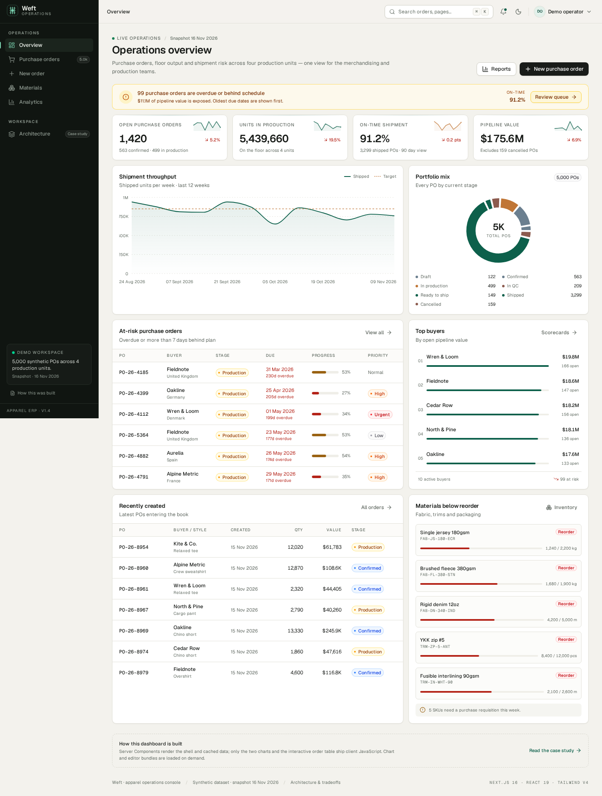
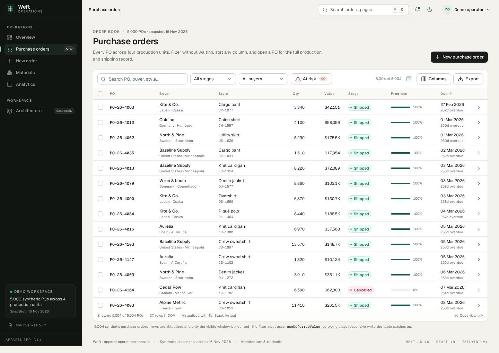
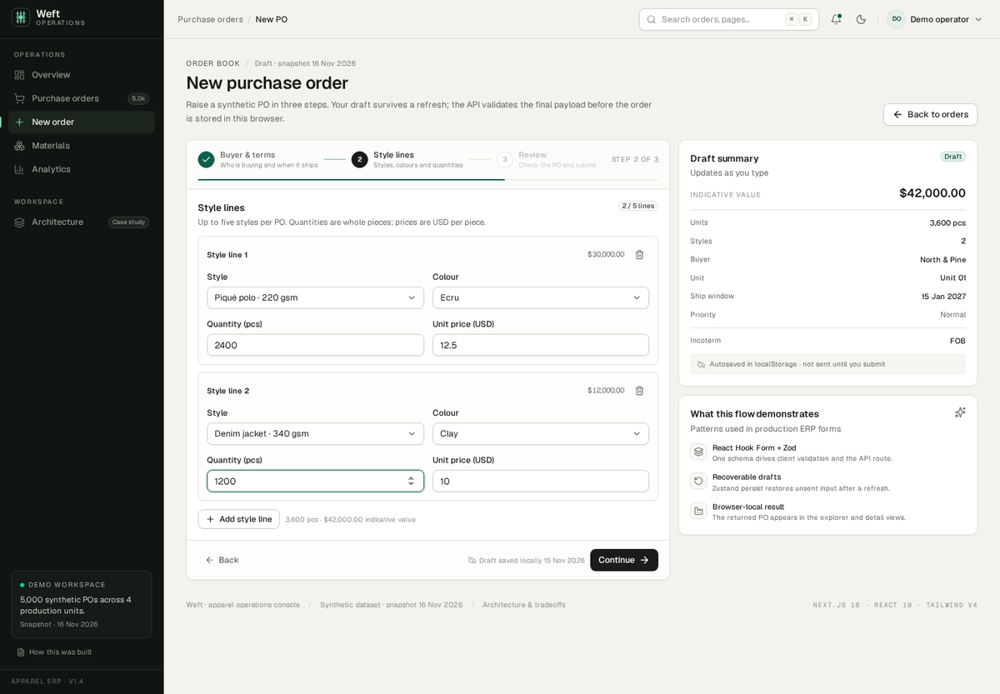
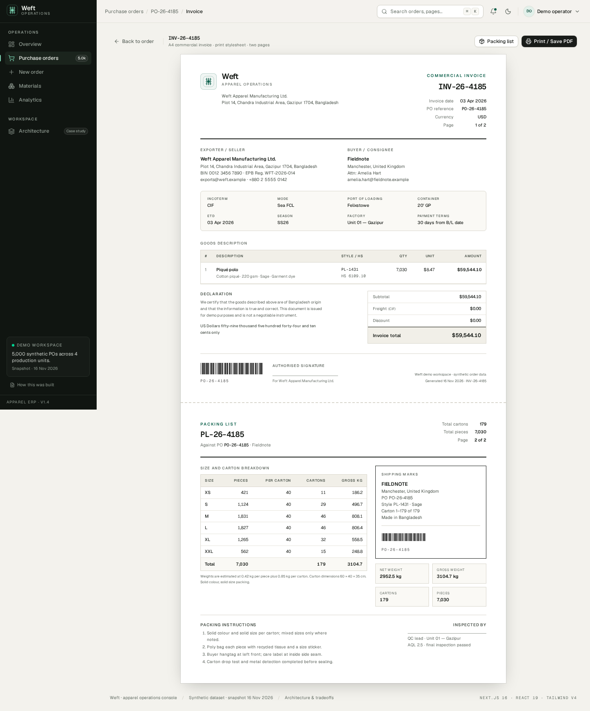

# Weft

**A data-dense apparel-manufacturing operations console built with Next.js 16, React 19 and TypeScript.**

Weft is a portfolio project, not a landing page. It models the unglamorous parts of an ERP front end: a 5,000-row virtualized order book, typed multi-step forms, server/client boundaries, explicit caching, print-ready commercial documents and honest browser-local persistence.

> **Live demo:** [https://weft-erp.vercel.app](https://weft-erp.vercel.app)
>
> **Architecture case study:** in-app at `/architecture` · **Sample invoice:** [two-page A4 PDF](docs/weft-sample-invoice.pdf)



## Why this exists

Data-heavy business software is mostly judged in the details. A marketing page cannot demonstrate whether you can keep a 5,000-row grid responsive, split server and client components sensibly, validate one schema on both sides of the wire, or produce a document that prints without breaking.

Apparel manufacturing supplied the constraints: purchase orders, style/colour/size matrices, production stages, material coverage, factory capacity, buyer scorecards and shipping paperwork. Every screen has a job because the domain needs it, not because a component library had a demo.

The entire workspace runs on Vercel's free tier with no paid services. It is connected to a free Neon Postgres database for real persistence, while still falling back to deterministic local data when `DATABASE_URL` is absent — see [Database setup](docs/DB_SETUP.md).

## Screens

| Purchase order explorer | Order detail |
| --- | --- |
|  |  |

| New purchase order | Printable invoice |
| --- | --- |
|  |  |

| Materials | Analytics |
| --- | --- |
|  |  |

### Dark mode and mobile

| Dark mode | Mobile |
| --- | --- |
|  |  |

## What is in the app

| Route | What it demonstrates |
| --- | --- |
| `/` | Server-rendered KPI grid, 12-week throughput chart, shipment-risk queue, buyer concentration and a five-SKU low-stock callout. |
| `/orders` | 5,000 POs in a TanStack Table + Virtual grid. Sort, global search, stage/buyer/risk filters, column visibility, row selection, density preference, URL-addressable filters and CSV export. |
| `/orders/server` | Server-driven TanStack Table in manual mode: Postgres paging, sorting, stage/factory filters and full-text search with only 50 rows fetched at a time. |
| `/orders/import` | CSV batch validation preview using the shared Zod schema before any write. |
| `/orders/new` | Three-step React Hook Form wizard with a shared Zod schema, per-step validation, API submission and a recoverable Zustand draft. |
| `/orders/[id]` | Order summary, size allocation, line items, exploded material demand, landed cost, production timeline, governed status transitions with approvals and audit diff, lazy Tiptap notes and shipment/buyer rail. |
| `/orders/[id]/invoice` | Two-page A4 commercial invoice and packing list with totals, amount in words, carton allocation, a Code 39 PO barcode and a GS1 SSCC Code 128 carton label. |
| `/materials` | Twelve fabric/trim SKUs with BOM-based reservations, goods-in receipts, live coverage, reorder states, inbound supply and suggested buys. |
| `/analytics` | Factory output, on-time trend, capacity utilisation (Unit 04 intentionally over capacity), defect causes, buyer scorecards and CSV export. |
| `/architecture` | The engineering case study: RSC boundaries, cache design, grid tradeoffs, measured bundles, print strategy, accessibility and what was deliberately left out. |
| `/sign-in`, `/sign-up` | Email/password auth with Better Auth; sign-up creates a tenant organization. |
| `/api/orders` | `GET` scoped cached JSON for the active tenant; `POST` validates + persists a PO when signed in, otherwise falls back to browser-local demo mode. |

Cross-cutting details: command palette on <kbd>⌘</kbd>/<kbd>Ctrl</kbd>+<kbd>K</kbd>, light/dark themes, skip link, reduced-motion support, mobile slide-over navigation, custom 404/error boundaries, toasts and visible focus states.

## Stack

| Layer | Choice |
| --- | --- |
| Framework | Next.js 16.4.6 App Router, React 19.3.0, TypeScript 5 |
| Rendering | React Server Components, Cache Components, Partial Prefetching, React Compiler |
| Styling | Tailwind CSS 4.3.3, CSS custom-property design tokens, Geist Sans/Mono |
| Data grid | TanStack Table 8, TanStack Virtual 3 |
| Forms | React Hook Form 7, Zod 4, `@hookform/resolvers` |
| Client state | Zustand 5 with `persist` + `skipHydration` |
| Data fetching | SWR 2.5 for cached reads; Axios 1.21 for validated POST mutations |
| Database | Neon Postgres with Drizzle ORM; deterministic generator fallback |
| Auth & tenancy | Better Auth with organizations, roles and tenant-scoped queries |
| UI | shadcn-style copy-in Radix/Tailwind primitives, cmdk, Sonner, Lucide icons, next-themes |
| Charts | Recharts 3, loaded lazily |
| Editor | Tiptap 3 + DOMPurify, loaded on demand |
| Print | Server-generated Code 39 SVGs with `bwip-js` |
| Observability | `web-vitals` for browser-measured LCP/INP/CLS/FCP/TTFB |
| Tests | Vitest 5 + Playwright 1 |

## Architecture

```text
Server Components                     Client islands
─────────────────                     ──────────────
dashboard  ─┐                         orders explorer (Table + Virtual)
orders     ─┤                         charts (Recharts, lazy)
detail     ─┼──► src/lib/data/server.ts ──► seeded generator
invoice    ─┤       "use cache"            5,000 deterministic POs
materials  ─┤       cacheLife / cacheTag   fixed snapshot: 16 Nov 2026
analytics  ─┘
                                     Browser-local state
API route                            ───────────────────
GET  /api/orders  cached JSON        drafts, created POs, notes,
POST /api/orders  Zod → 422/201      table density (Zustand persist)
```

The data layer is deliberately shaped like a repository. `generateOrders()` is a seeded generator: a fixed anchor date and a mulberry32 PRNG produce the same 5,000 purchase orders on every server and every build. Buyer, style, factory, progress, risk and due dates all come from that one stream, so the dashboard, explorer, detail page, invoice and analytics cannot disagree.

```ts
// src/lib/data/server.ts
export async function getOrders() {
  "use cache";
  cacheLife("days");
  cacheTag("orders");
  return generateOrders();
}
```

The dashboard refreshes hourly; the order book and detail records are cached daily. `/api/orders` adds a one-day `s-maxage`. Cache tags make invalidation a one-line change when a real mutation arrives.

**Server/client line.** Layout, KPI grids, risk queues, order summaries, invoices and analytics copy are Server Components. Client islands exist only for interaction: the table, charts, command palette, theme toggle, form, notes editor and print toolbar. Charts and Tiptap are lazy-loaded so their weight stays off first paint.

**State ownership.** SWR owns the read path, Axios owns the validated POST mutation, and Zustand owns drafts, browser-created POs, edited notes and table density with `skipHydration` and explicit rehydration flags to avoid SSR mismatches. Filters live in the URL so a copied queue link restores the view.

**Persistence modes.** With no `DATABASE_URL`, the API validates submissions and returns the created record, but writes it to `localStorage` with `persisted: false`. When Neon is configured, signed-in users write into their organization; the API returns `persisted: true` and revalidates tenant cache tags. Public visitors get a read-only demo scoped to the seeded demo organization. Drafts, table density and theme stay in `localStorage` either way. Setup is documented in [`docs/DB_SETUP.md`](docs/DB_SETUP.md).

## Operations

Server routes emit structured JSON logs with request and tenant IDs; `instrumentation.ts` registers OpenTelemetry for Vercel Tracing. Client errors are reported to `/api/errors`, and `metric()` emits `orders.created` and `orders.status_changed` samples. A daily private Vercel Schedule runs `api/order-reminders.ts`. GitHub Actions checks production routes every 30 minutes and runs `npm audit --omit=dev --audit-level=high` on every push. Responses include CSP, frame, referrer and permissions headers; mutating APIs check same-origin. Shared rate-limit counters live in Neon's `rate_limit_events` table.

Runbooks and architecture decisions live in [`docs/RUNBOOK.md`](docs/RUNBOOK.md), [`docs/API.md`](docs/API.md), [`docs/ACCESSIBILITY.md`](docs/ACCESSIBILITY.md) and [`docs/adr/`](docs/adr/).

## Documents and integrations

`/api/openapi` publishes an OpenAPI 3.1 description of the order, query, status, invoice and receipt endpoints. Machine clients can create a scoped API key at `POST /api/settings/api-keys` and authenticate against `/api/orders/query` with `x-api-key`. Webhooks registered at `POST /api/settings/webhooks` receive HMAC-signed `order.created` and `order.status_changed` events. `POST /api/orders` accepts an `Idempotency-Key` header so retries return the original response.

Invoices are immutable: `POST /api/orders/[id]/invoices` stores a SHA-256-hashed snapshot with an incrementing version. `GET /api/orders/[id]/pdf` returns a two-page PDF commercial invoice and packing list. The packing list includes a deterministic SSCC-18 validated with the GS1 check-digit algorithm and rendered as Code 128. CSV batches can be previewed at `/orders/import` before any write. XLSX import is not implemented yet.

## Inventory and MRP

Each style has a bill of materials (fabric, thread, label, carton and optional trims). Creating a PO reserves those quantities against open orders; shipping consumes them and cancelling releases them. Goods receipts recorded in `/materials` add stock, and coverage weeks, reorder status and suggested buys are recomputed from baseline stock + receipts − reservations. The order detail page shows the exploded material demand and a landed-cost estimate (unit price + 6% freight + 2% duty).

## Server-driven mode

`/orders/server` queries Postgres directly through `/api/orders/query`. Paging, sorting, stage/factory filters and full-text search happen in SQL; the client receives one page of 50 rows at a time and still renders it with TanStack Virtual. Indexes cover tenant, status, factory, buyer, due date and a GIN full-text expression over PO number, buyer and style. CI enforces per-route gzip bundle budgets.

## Auth and roles

Better Auth runs in the app with Drizzle tables in the same Neon database. Sign-up creates an organization; the creator becomes `owner`. Roles are `owner`, `admin`, `merchandiser`, `factory` and `viewer`, declared with Better Auth access control. `getViewer()` resolves the session's active organization on the server; every read and write is scoped by `organization_id`. Mutations check both authentication and permission, and the proxy blocks unauthenticated API writes before they reach the route handler.

The seeded demo account is `demo@weft.local` / `demo1234`. Public visitors can browse the demo organization read-only without signing in.

## The 5,000-row grid

`/orders` fetches the full synthetic dataset once, then lets TanStack Table handle sorting, global filtering, selection and column visibility. TanStack Virtual mounts only the visible window plus 12 rows of overscan, so roughly 40 row elements exist in the DOM at a time.

- `useDeferredValue` keeps the search input responsive while the 5k-row filter catches up.
- Base filters are memoized before TanStack's row model; column definitions are module-level.
- Sticky header, fixed row heights and skeleton states prevent layout shift.
- Density preference persists through Zustand with `skipHydration`.
- The table exposes `role="table"`, `aria-rowcount`, `aria-rowindex` and `aria-selected` on virtualized rows.
- Bulk actions are explicitly demo-only; CSV export is real.

This pattern is right for a free, read-only demo. A production version beyond roughly 50k rows would need server-side pagination, indexed search, permission-scoped queries and server-side sort/filter.

## Forms

The new-PO flow validates buyer/terms, style lines and review with one Zod schema in the browser and the same schema on the server. The API returns `422` with field issues if a client bypasses the form.

One Cache Components edge case is worth calling out: React Hook Form's `useFieldArray` calls `crypto.randomUUID()` during render. With Cache Components enabled, that is an unstable value in the prerendered shell and fails the build. Rather than disabling SSR for the entire page, the field array lives in a step that only mounts after interaction. The page keeps its static shell and the random IDs are created on the client.

Drafts are debounced into a versioned Zustand store. Returning to the page restores the draft only after persistence hydrates, so SSR never overwrites saved input.

## Performance

These are **initial route JS** figures from the production build, summed from each route's script graph and gzipped at maximum compression. They measure transfer size, not parse/execute cost. Lighthouse results below are from local runs of the same build, not estimated.

| Route | Initial JS, gzip | Over shared shell |
| --- | ---: | ---: |
| `/` | 268.0 KB | +2.3 KB |
| `/analytics` | 268.4 KB | +2.8 KB |
| `/architecture` | 269.9 KB | +4.2 KB |
| `/materials` | 272.5 KB | +6.8 KB |
| `/orders/[id]/invoice` | 275.7 KB | +10.0 KB |
| `/orders/[id]` | 292.8 KB | +27.2 KB |
| `/orders` | 313.2 KB | +47.5 KB |
| `/orders/new` | 347.6 KB | +81.9 KB |

The shared baseline is about 266 KB gzip: React 19, the App Router runtime, the persistent shell, Radix primitives and the Better Auth session client. The shell is interactive on every page, so this is a deliberate cost; hiding it behind a client-only boundary would trade a smaller first load for a layout flash on every navigation. The dashboard adds only 2.3 KB because its KPI grid, risk table and buyer list are Server Components and its charts are lazy.

Weight kept off the first load:

- Recharts: ~131 KB gzip (three lazy chunks, combined)
- Tiptap: ~134 KB gzip (one on-demand chunk)
- DOMPurify: ~14 KB gzip (loaded with the editor)

### Local Lighthouse run

Measured against `next start` on one workstation with the **desktop preset**, one pass per route. All eight reviewed routes — dashboard, orders, new PO, analytics, materials, architecture, detail and invoice — scored **100** for performance, accessibility, best practices and SEO.

| Metric | Dashboard | Orders |
| --- | ---: | ---: |
| First Contentful Paint | 0.28 s | 0.26 s |
| Largest Contentful Paint | 0.28 s | 0.26 s |
| Total Blocking Time | 50 ms | 70 ms |
| Cumulative Layout Shift | 0.005 | 0.012 |
| Speed Index | 0.69 s | 0.54 s |

TBT is a lab proxy for INP, not a field INP measurement. A separate Chromium check measured `/orders` table-ready at about 1.2 s, `/api/orders` at 183,123 bytes transferred (2,220,357 decoded) and 28 mounted row elements. Treat all of these as a local sanity check, not a benchmark or a promise about low-end devices.

## Print output

`/orders/PO-26-4001/invoice` renders a two-page A4 commercial invoice and packing list. Print CSS hides the app shell, resets the content width, sets 12 mm sheet padding and forces a page break before the packing list. Colours are preserved with `print-color-adjust: exact`; totals, amount in words, size allocation, carton weights and the barcode all derive from the same order record as the detail page. There is no PDF service or serverless Chromium.

The verified sample is committed at [`docs/weft-sample-invoice.pdf`](docs/weft-sample-invoice.pdf). To reproduce it, open the invoice, choose **A4**, enable **background graphics**, and turn off browser headers and footers.

The barcode is a real Code 39 SVG generated server-side by `bwip-js` through `/api/barcode`, so it is scannable. It is not a GS1/GTIN shipping label — a certified label would still need GS1 validation and fixed symbology rules.

## Quality

Verified on 16 Nov 2026:

- `npm run build` — production build passes (28 route entries, including static order and invoice samples)
- `npx tsc --noEmit` — clean
- `npx eslint src` — clean
- `npm test` — 22 Vitest tests across data builders, BOM explosion, GS1 identifiers, CSV import, materials, schema rules, workflow transitions, DB mappers and invoice wording
- Production QA — creating a local PO, draft autosave/restore, local detail after reload, local invoice print, no console errors
- Print QA — sample invoice is exactly two A4 pages
- Lighthouse desktop — accessibility, best practices and SEO 100 on all eight routes; performance 95–100 after tenant-aware server reads, with no failed accessibility audits
- Playwright — 12 end-to-end tests covering dashboard, command palette, Web Vitals panel, the 5,000-row explorer, PO draft/create/print, materials→PO prefill, auth, tenant isolation, workflow transitions, the server query, material stock flow, OpenAPI, invoice versions, PDF, import preview, idempotency and API keys
- Browser Web Vitals — `web-vitals` reports LCP, INP, CLS, FCP and TTFB into a case-study panel using locally stored values only

The Vitest suite covers the deterministic order book, dashboard/analytics consistency, size allocation, materials thresholds, new-order validation, CSV safety, DB mappers and amount-in-words formatting. Playwright covers the critical UI flows on every CI run. Visual regression and field INP collection are still out of scope.

Accessibility work includes a skip link, labelled landmarks, semantic data-grid roles, visible focus rings, keyboard-operable Radix dialogs/menus, status labels that do not rely on colour alone, reduced-motion handling and loading/error/empty states.

## Demo boundaries

- All manufacturer, buyer, supplier, purchase order, invoice, barcode and performance data is **synthetic**. Weft is a portfolio project; nothing here is a real commercial document.
- Authentication and multi-tenant role boundaries are real, but there are no real customers. Status changes are database writes with an audit trail; bulk actions that look destructive are labelled demo-only or disabled.
- With a database configured, newly created POs are real Postgres rows served to every visitor. Without one they live in `localStorage` only. Drafts, notes, table density and theme remain per-browser in Phase 1.
- The interface is desktop-first. Compact 28–32 px controls suit mouse and keyboard work but are below the 44 px touch-target recommendation. Mobile gets a slide-over nav and horizontally scrollable tables rather than a separate operator app.
- No field INP, user count or synthetic benchmark is claimed. Lighthouse figures are explicitly local lab measurements.

## Getting started

Requires Node.js 20.9+ and npm.

```bash
npm install
npm run dev
```

Open [http://localhost:3000](http://localhost:3000). The demo snapshot is fixed at **16 November 2026**; all generated dates are relative to that anchor.

| Command | Purpose |
| --- | --- |
| `npm run dev` | Start the development server |
| `npm run build` | Production build |
| `npm start` | Serve the production build |
| `npm run lint` | ESLint |
| `npm test` | Vitest, single run |
| `npm run test:e2e` | Playwright end-to-end suite |
| `npx tsc --noEmit` | TypeScript check |

Optional environment variable: `NEXT_PUBLIC_SITE_URL` sets the canonical metadata URL. On Vercel, `VERCEL_PROJECT_PRODUCTION_URL` is used automatically when it is absent.

## Database (optional)

Without configuration the app uses the deterministic generator and browser-local POs. To enable real persistence on a free tier, follow [`docs/DB_SETUP.md`](docs/DB_SETUP.md). Short version:

```bash
# 1. Create .env.local with DATABASE_URL from Neon (never commit it)
# 2. Create the tables and seed the same 5,000 generated orders
npm run db:push
npm run db:seed
```

| Command | Purpose |
| --- | --- |
| `npm run db:push` | Apply the Drizzle schema to Neon |
| `npm run db:seed` | Insert 5,000 POs, details and 12 materials (idempotent) |
| `npm run db:generate` | Generate SQL migrations after a schema change |
| `npm run db:studio` | Open Drizzle Studio |

Add the same `DATABASE_URL` to Vercel's environment variables and redeploy. Reads stay behind `"use cache"` + `cacheTag`, and writes call `revalidateTag`.

## Deploying and CI/CD

**CI** runs on every push and pull request through [`.github/workflows/ci.yml`](.github/workflows/ci.yml): `npm ci`, TypeScript, ESLint, Vitest and a production build. No secrets are needed — without `DATABASE_URL`, the build uses the deterministic generator fallback.

**Hosting** is Vercel's free Hobby tier. The source is already at `RaiyanKhan19-41453-3/weft-erp`.

1. Import the repository at [vercel.com/new](https://vercel.com/new), or run:

   ```bash
   npx vercel@latest login
   npx vercel@latest link
   npx vercel@latest --prod
   ```

   When asked for a project name, enter **`weft-erp`** explicitly rather than accepting the folder-derived default.

2. Add the Neon variables to **Vercel → Project → Settings → Environment Variables**. `DATABASE_URL` enables database persistence; the other variables pulled by `neon init` (`DATABASE_URL_UNPOOLED`, `NEON_BRANCH`, `NEON_BRANCH_ID`, `NEON_FUNCTION_HOST_SUFFIX`) can also be added for completeness. Never commit them.

3. Enable Vercel's Git integration. Pushes to `main` deploy to production; pull requests get preview deployments. GitHub Actions CI checks run on the same events.

4. After the first deploy, replace the **Live demo** placeholder at the top of this README with the production URL. Optionally set `NEXT_PUBLIC_SITE_URL` to the final domain so Open Graph metadata uses it.

## Project structure

```text
components.json              shadcn CLI config for the Radix/Tailwind primitives
src/
  app/
    (app)/                  dashboard, orders, detail, invoice, materials,
                            analytics, architecture
    (auth)/                 sign-in and sign-up pages
    api/auth/[...all]/      Better Auth handler
    api/orders/route.ts     cached GET + validated POST
    api/orders/query/route.ts paged, sorted, FTS Postgres query
    api/orders/[id]/status/ governed transitions + audit diff
    api/orders/[id]/approvals/ approval decisions by owners/admins
    api/barcode/route.ts    server-generated Code 39 SVG
  components/
    orders/                 explorer, columns, toolbar, form, detail,
                            status control, notes, invoice, barcode, print toolbar
    performance-vitals.tsx  browser-measured Web Vitals panel
    dashboard/ analytics/   lazy chart islands
    materials/ shell/ ui/   table, navigation, primitives
  lib/
    data/                   seeded generator, materials, server cache helpers
    db/                     Drizzle schema, auth schema, client, mappers, seed
    auth.ts                 Better Auth server config
    auth-client.ts          Better Auth React client
    auth-guards.ts          viewer, role and tenant helpers
    permissions.ts          role/permission definitions
    stores/                 Zustand stores (drafts, local POs, notes, prefs)
    validation/             shared Zod schema
    __tests__/              Vitest suite
tests/e2e/                  Playwright critical-flow suite
drizzle/                    generated SQL migrations
docs/
  screenshots/              README assets
  weft-sample-invoice.pdf   verified two-page A4 output
  DB_SETUP.md               free Neon database setup
```

## If this became a real product

1. Hosted Postgres is already wired behind the cached repository; next is auth, migrations in CI and environment branches.
2. Auth and role boundaries for merchandiser, factory and buyer views.
3. Concurrency control and richer role boundaries around the existing status mutation and audit trail.
4. Server-side pagination, indexed search and permission-scoped queries.
5. Visual regression and real-user INP collection, plus CI bundle budgets.
6. GS1/GTIN validation and label compliance around the generated Code 39 barcode.

## Author

Built as a front-end portfolio project. The source is available for review; no reuse licence is granted.
